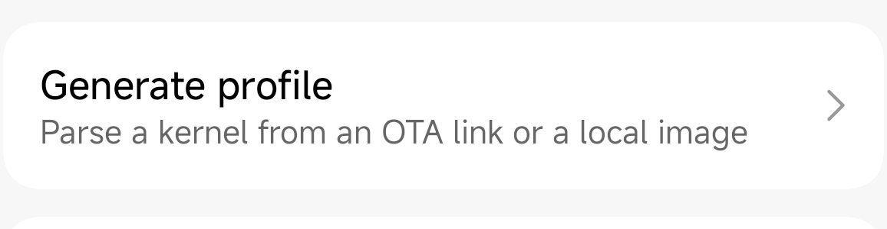
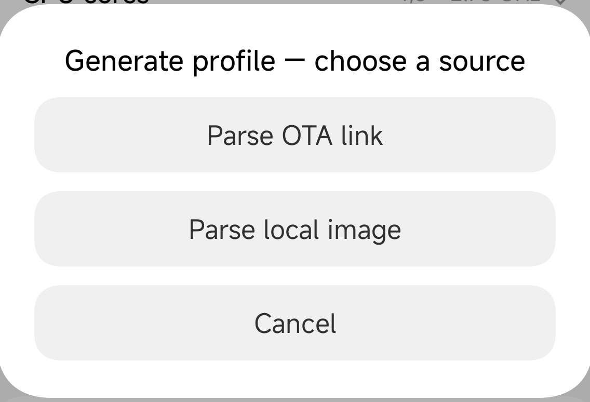
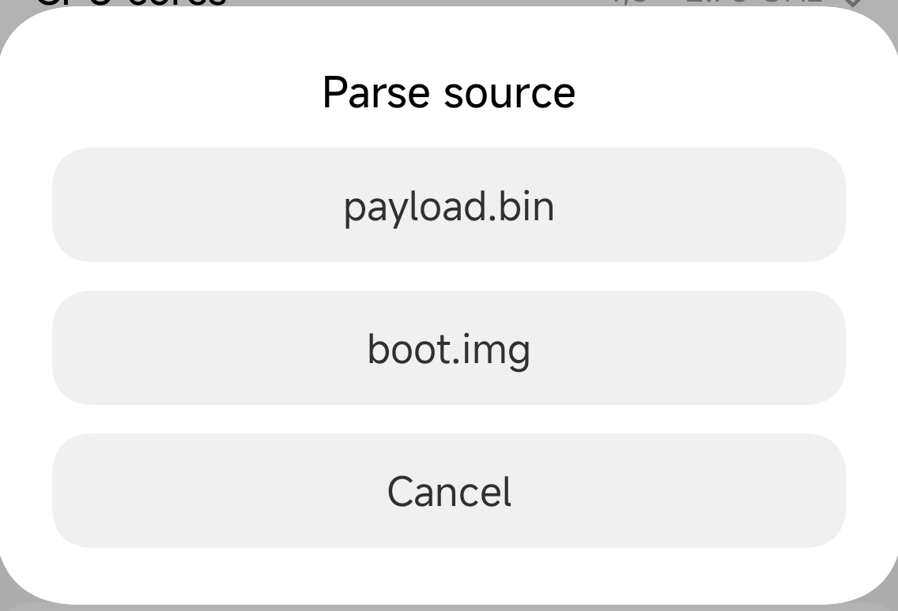
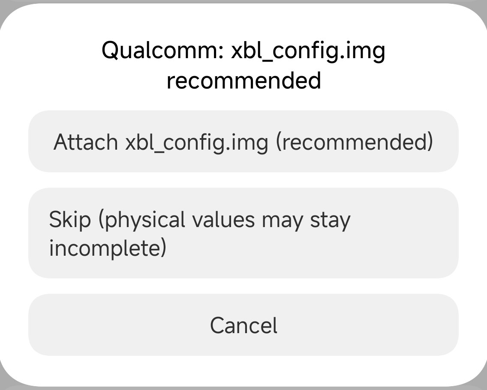
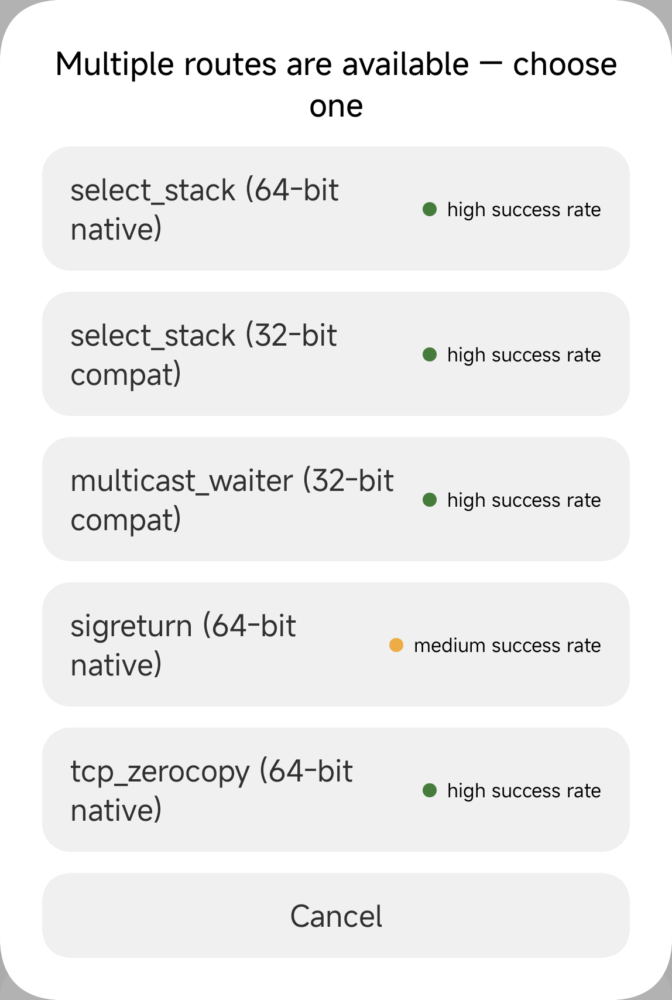
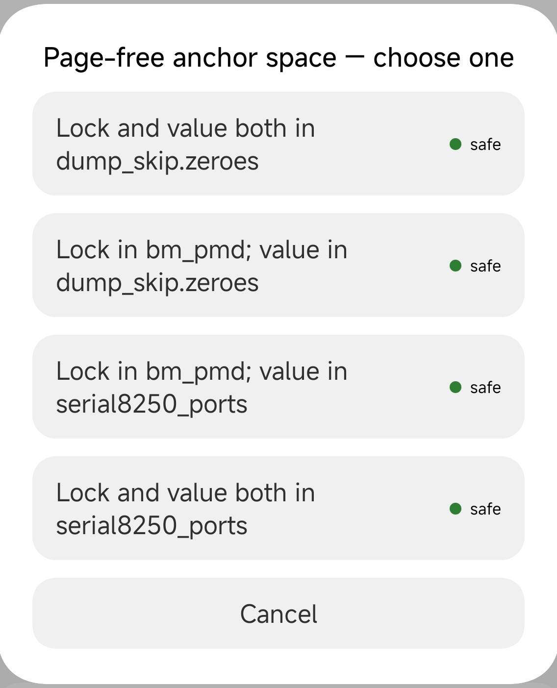

# GhostLock — broad kernel support, measured success

> 中文: [README_ZH.md](README_ZH.md)

Temporary root for Android kernels that have not yet patched CVE-2026-43499.

This repository is a fork of [YuKongA/ghostlock-app](https://github.com/YuKongA/ghostlock-app).
**This branch rebuilds the parts of the pipeline that decide whether a generated profile is
accurate and whether a run completes.**

## Design principles

1. Support comes from a profile generator that reads the kernel image, not from a hand-maintained
   list of builds.
2. Built-in profiles do not define the support boundary. A kernel that is not listed can generate
   its own profile, and an upstream profile the maintainer has not personally tested is not removed
   for that reason.
3. A correct profile runs at the full success rate its route is capable of.

## Profile generation accuracy

Tested against 40+ kernels: every one produces an accurate profile, identical to the results seen on
the real device or in the emulator. The full list is in [`docs/DESIGN.md`](docs/DESIGN.md).

## Root success rate

Measured on real phones, one run per fresh boot. The tables were measured with the r8
release-candidate build and are split into three groups by how much a run depends on a page. When
the same phone, kernel and route appear twice, the two rows are two page-dependency configurations.

**Fully page-free**

| Phone | Kernel | Route | Completed | Typical time | Measured |
|---|---|---|---|---|---|
| Redmi K50 Ultra (`diting`) | 5.10.236 | `select_stack` | 10/10 | 13.8–15.9 s | 2026-10-31 |
| Redmi K50 Ultra (`diting`) | 5.10.236 | `sigreturn` | 6/10 (4 runs rebooted mid-run) | 12.8–13.4 s | 2026-10-31 |
| Redmi K50 Ultra (`diting`) | 5.10.236 (custom build) | `multicast_waiter` | 10/10 | 12.5–14.0 s | 2026-10-31 |
| Redmi K50 Ultra (`diting`) | 5.10.81 | `select_stack` (32-bit compat) | 10/10 | 6.6–7.8 s | 2026-10-31 |
| POCO X6 Pro 5G (`duchamp`) | 6.1.138 | `select_stack` | 10/10 | 20.8–23.1 s | 2026-11-01 |
| OnePlus 13T | 6.6.66 | `select_stack` | 10/10 | 22.3–22.7 s | 2026-11-01 |
| Xiaomi K90 Pro Max (`myron`) | 6.12.23 | `select_stack` | 10/10 | 20.3–22.6 s | 2026-10-31 |

**Partly page-based**

| Phone | Kernel | Route | Completed | Typical time | Measured |
|---|---|---|---|---|---|
| POCO X6 Pro 5G (`duchamp`) | 6.1.138 | `select_stack` | 10/10 | 35.3–46.1 s | 2026-10-31 |
| OnePlus 13T | 6.6.66 | `select_stack` | 10/10 | 45.9–69.5 s | 2026-10-31 |

**Fully page-based**

| Phone | Kernel | Route | Completed | Typical time | Measured |
|---|---|---|---|---|---|
| POCO X6 Pro 5G (`duchamp`) | 6.1.138 | `tcp_zerocopy` | 10/10 | 25.0–39.3 s | 2026-10-31 |

*All numbers are from the r8 release-candidate build.*

## Prerequisites

> [!WARNING]
> **Do not try this on vivo/iQOO phones, or on any phone with built-in anti-root protection. The
> maintainer does not own such a phone, the attack flow has not been tuned for it, and there is a
> risk of bricking the device.**  
> **You use this app entirely at your own risk.**

- Android 12 or newer.
- The kernel and its security patch level are not yet patched for CVE-2026-43499.
- A KernelSU-family root manager is installed first: KernelSU, BakaSU (formerly ReSukiSU), or
  KowSU. Each manager gained temporary-root support in a different version; use the newest one you
  can.

## Supported devices

Support is organized by **kernel family**, not by phone model or by a list of individual builds:

**5.10 · 5.15 · 6.1 · 6.6 · 6.12**

If your kernel belongs to one of those families and is not patched for CVE-2026-43499, the app can
generate a profile from your own image and try to run it. The built-in profiles are only the ones
that have passed independent verification; for a kernel that is not built in, you can generate a
profile yourself. The exact bundled list is in
[`docs/kernel_profiles/BUNDLED_PROFILES.md`](docs/kernel_profiles/BUNDLED_PROFILES.md).

Kernels outside these families have no derivation template and are currently out of scope.

## Quick start

1. Install the APK and open the app.
2. The home screen checks your kernel.
3. If it reads **Supported / Profile ready**, keep the app in the foreground and tap **Run**.
4. Wait for `KernelSU ready`. `su` works until the next reboot.

## Generating a profile

> [!WARNING]
> Some fields in a profile are measured on the phone itself. Do not generate a profile for any
> kernel other than the one the phone is running.

1. Note the exact OS build.
2. For a Qualcomm phone, get `boot.img`, `xbl_config.img` and `uefi.img` from the same OS build;
   for a MediaTek phone, get `boot.img`, `vendor_boot.img` and `dtbo.img`. Extract them from the
   full OTA's `payload.bin`, or from the fastboot package, and copy them to the phone's storage.
3. Open the app and tap **Generate profile** on the home screen:

   

4. Choose **Parse local image**, then pick `boot.img` (or `payload.bin`):

   | Source | Image type |
   |---|---|
   |  |  |

5. Attach the platform image the app asks for (skipping is not recommended — the physical address
   may be wrong):
   - Qualcomm: `xbl_config.img`; if the physical load is still missing, `uefi.img`.
   - MediaTek: `vendor_boot.img`; if the offset is still missing, `dtbo.img`.

   

6. If the app asks **Multiple routes are available — choose one**, pick from the row descriptions.
   The grade on the right is about the route itself, not about your kernel; it reads **not
   measured** when there is no evidence:

   

7. If the app asks for a page-free plan, choose from the row descriptions. Each row states where
   the lock and the value come from; the dangerous Samsung serial-port area is labelled separately:

   

8. If **Slab stride** appears, pick a value marked **Confirmed** or **Consistent**, or skip it and
   merge the measurement from the home screen later.

9. **Export** the profile, then select it. A generated profile that is not exported is lost when
   you leave the screen.

## If a run fails

- **Reboot and retry.** A fresh boot is the strongest single lever; one attempt per boot.
- **Check the plan and route choice** if the app offered one; each option can produce a different
  success rate.
- **Export the log** and attach it to the issue, together with the profile-generation log and the
  attack-run log.

## Why the success rate is higher

An exploit has many steps, and a mistake in any one of them lowers the success rate of the whole
chain. This branch optimizes the following steps:

1. **The main routes no longer depend on a sprayed page.** The old route leaked a page, freed it,
   reclaimed it with controlled contents, and hoped the allocator returned the same page; a page
   reclaimed elsewhere could take the phone down. The lock used for the write now sits in a fixed,
   all-zero region of the kernel. (`tcp_zerocopy` is the exception: its lock is a crafted object
   and stays page-based by construction.)
2. **Profiles are generated from measurable facts.** The app fills a profile from facts where it
   has them and falls back to heuristics only where it has none. A profile that was a few bytes off
   used to fail in the middle of the chain; that class of failure is gone.
3. **Older 5.10 kernels get a route that fits.** Two extra routes cover kernels the default route
   cannot reach: one for older 5.10 layouts, and a 32-bit helper for 5.10.43 / 5.10.81 / 5.10.101,
   whose stack layouts are outside the 64-bit route's reach.
4. **A failed attempt cleans up after itself.** Kernel state left behind by one attempt used to
   spoil the next. The app disarms after every attempt and retries the early stages, so one miss
   does not end the run.
5. **A stage that cannot finish stops.** A walk that would never end used to leave the app waiting
   indefinitely. A stage that cannot complete now stops and reports where it stopped.
6. **The log says what happened.** The app logs with as little delay as it can and can export the
   log.

## Acknowledgements

This repository is a fork of [YuKongA/ghostlock-app](https://github.com/YuKongA/ghostlock-app),
Apache License 2.0. Upstream in turn credits:

- [NebuSec/CyberMeowfia](https://github.com/NebuSec/CyberMeowfia)
- [JoinChang/ghostlock-oneplus](https://github.com/JoinChang/ghostlock-oneplus)
- [x-spy/CVE-2026-43499-popsicle](https://github.com/x-spy/CVE-2026-43499-popsicle)

The app also uses [miuix](https://github.com/compose-miuix-ui/miuix),
[Shizuku](https://github.com/RikkaApps/Shizuku),
[Typesafe Config](https://github.com/lightbend/config) and Apache Commons Compress. The diting 5.10
offsets were initially based on the OPPO Reno10 Pro+ (CPH2521).

## License

Apache License 2.0 — see [LICENSE](LICENSE). Root is temporary and probabilistic. The built-in
profiles are based on real-device or emulator verification; the actual run result is what counts.
You use this software entirely at your own risk.
