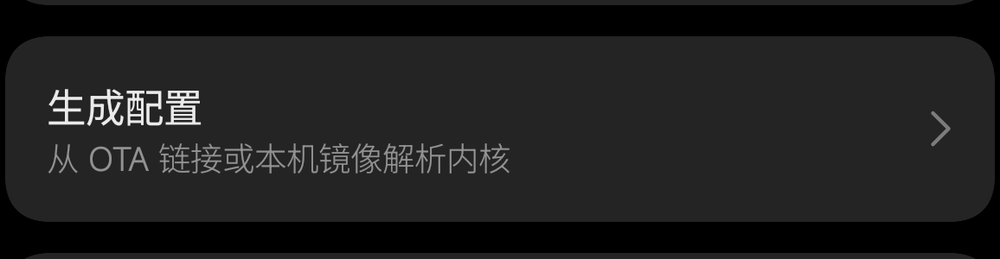
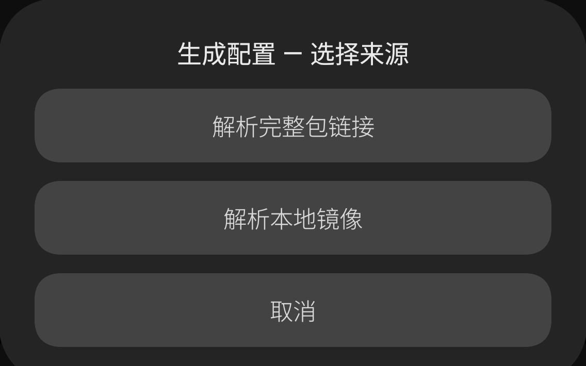
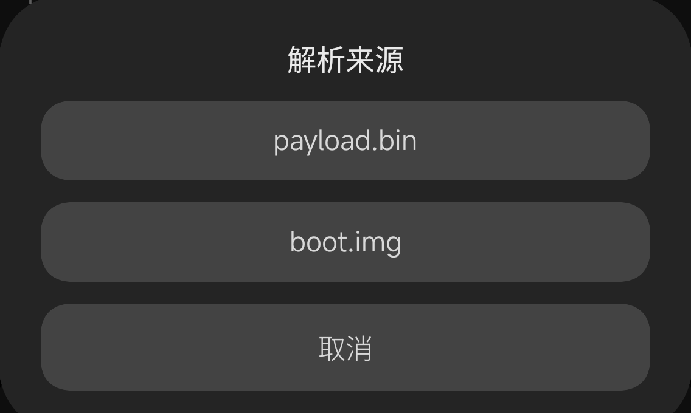
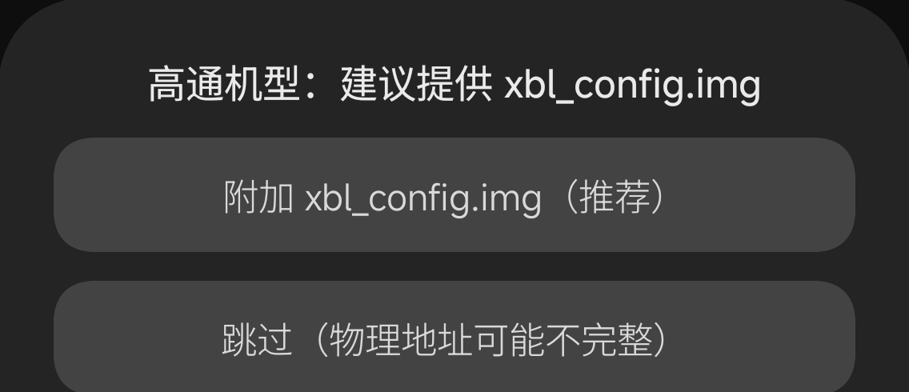
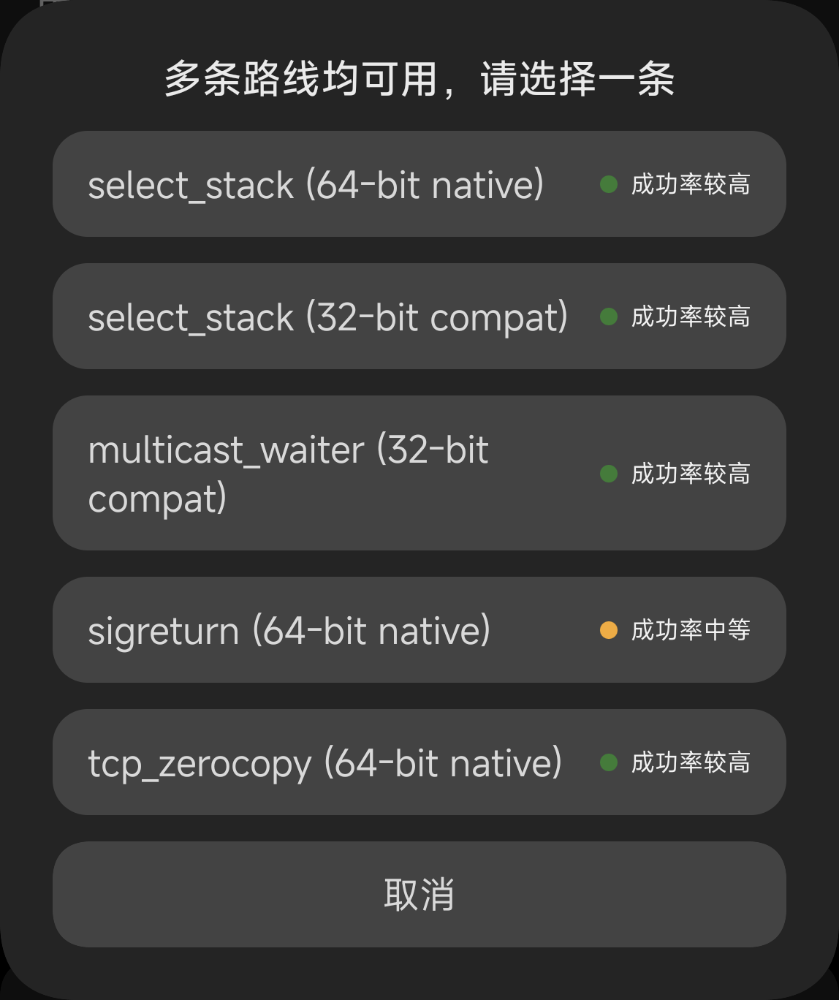
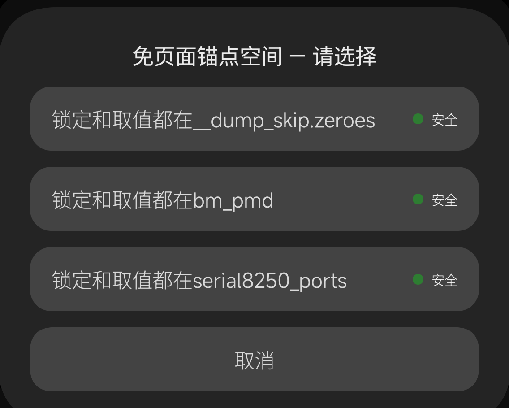
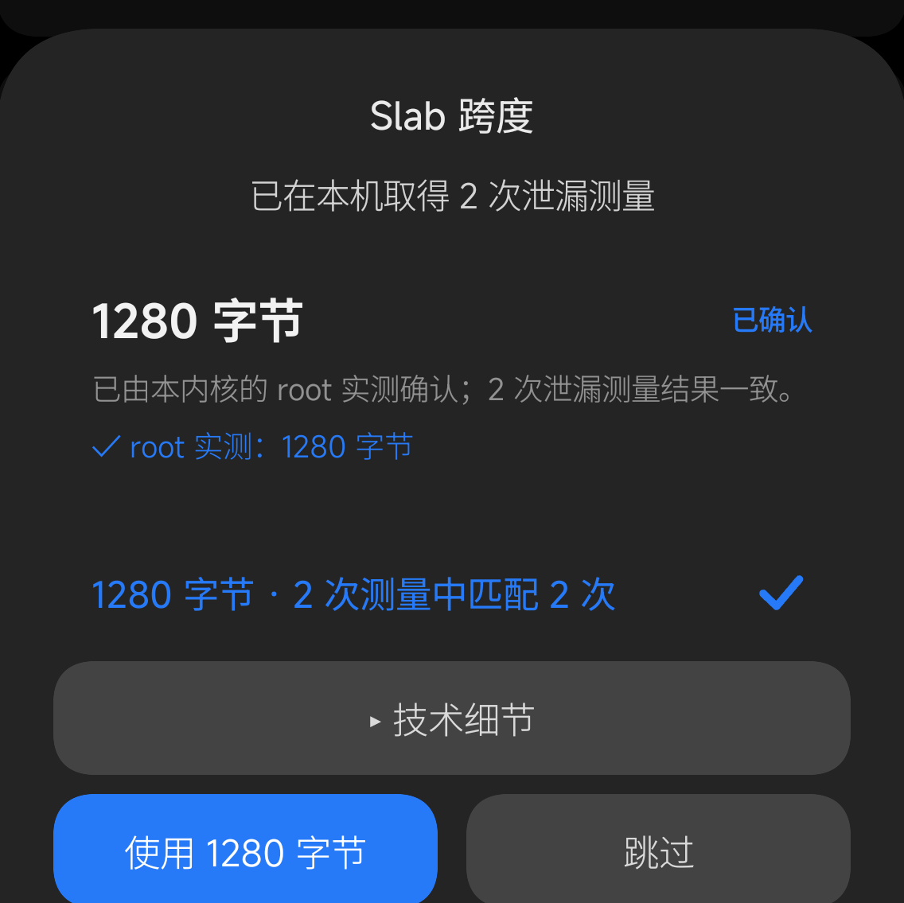

# 为广泛内核支持及成功率优化的GhostLock

> English: [README.md](README.md)

为尚未修补 CVE-2026-43499 漏洞的安卓内核提供临时 root。

本仓库是 [YuKongA/ghostlock-app](https://github.com/YuKongA/ghostlock-app) 的分支。
**本分支优化了决定配置文件导出准确性和漏洞利用成功率的关键部分**。

## 本分支的设计哲学
1. 内核支持来自精确的配置生成器，而不是逐一内置。
2. 内置配置不定义支持范围。未列出的内核可以自行生成；未由维护者亲自测试的上游配置也不会因此移除。
3. 每个正确的配置文件以没有妥协的成功率执行。

## 配置文件生成准确性
测试使用40+个内核，全部准确生成配置文件，与实机/模拟器结果完全相同。具体清单见[`docs/DESIGN_ZH.md`](docs/DESIGN_ZH.md)。

## root成功率

在真机上测量，每次重启只跑一次。
下表使用r8的发布候选构建测得，按是否使用页面分为三组。同一手机/内核/路线出现两行时，是两种页面依赖配置的两次测量。

**完全免页面**

| 手机 | 内核 | 路线 | 完成 | 典型耗时 | 测量于 |
|---|---|---|---|---|---|
| Redmi K50 Ultra（`diting`） | 5.10.236 | `select_stack` | 10/10 | 13.8–15.9 秒 | 2026-10-31 |
| Redmi K50 Ultra（`diting`） | 5.10.236 | `sigreturn` | 6/10 （4 次运行中重启） | 12.8–13.4 秒 | 2026-10-31 |
| Redmi K50 Ultra（`diting`） | 5.10.236 (custom build) | `multicast_waiter` | 10/10 | 12.5–14.0 秒 | 2026-10-31 |
| Redmi K50 Ultra（`diting`） | 5.10.81 | `select_stack` （32 位兼容） | 10/10 | 6.6–7.8 秒 | 2026-10-31 |
| POCO X6 Pro 5G（`duchamp`） | 6.1.138 | `select_stack` | 10/10 | 20.8–23.1 秒 | 2026-11-01 |
| OnePlus 13T | 6.6.66 | `select_stack` | 10/10 | 22.3–22.7 秒 | 2026-11-01 |
| Xiaomi K90 Pro Max（`myron`） | 6.12.23 | `select_stack` | 10/10 | 20.3–22.6 秒 | 2026-10-31 |

**部分使用页面**

| 手机 | 内核 | 路线 | 完成 | 典型耗时 | 测量于 |
|---|---|---|---|---|---|
| POCO X6 Pro 5G（`duchamp`） | 6.1.138 | `select_stack` | 10/10 | 35.3–46.1 秒 | 2026-10-31 |
| OnePlus 13T | 6.6.66 | `select_stack` | 10/10 | 45.9–69.5 秒 | 2026-10-31 |

**完全基于页面**

| 手机 | 内核 | 路线 | 完成 | 典型耗时 | 测量于 |
|---|---|---|---|---|---|
| POCO X6 Pro 5G（`duchamp`） | 6.1.138 | `tcp_zerocopy` | 10/10 | 25.0–39.3 秒 | 2026-10-31 |

*数字来自r8候选构建。*

## 使用前提
> [!WARNING]
> **vivo/iQOO 及未来任何内置反 root 的机型禁止直接尝试，维护者不持有这类机型，攻击流程未对其优化，有变砖的风险。**  
> **使用本 App 的一切风险由使用者自行承担。**

- 系统为Android 12 或更高。
- 内核及安全补丁尚未修补 CVE-2026-43499 漏洞。
- 提前安装下列 root 管理器之一： KernelSU、BakaSU（曾是ReSukiSU）或 KowSU。每个管理器支持临时 root 的首个版本各不相同，尽可能下载新版。

## 支持的设备

支持按内核家族划分，不按机型或具体构建逐一列举：

**5.10 · 5.15 · 6.1 · 6.6 · 6.12**

只要内核属于以上家族且尚未修补 CVE-2026-43499，App 就可以从你自己的镜像文件尝试生成配置并运行。内置配置仅为通过独立验证的部分，未内置可以自行生成。完整的内置列表见 [`docs/kernel_profiles/BUNDLED_PROFILES_ZH.md`](docs/kernel_profiles/BUNDLED_PROFILES_ZH.md)。

以上家族之外的内核目前没有对应的推导模板，不在支持范围内。

## 快速开始

1. 安装 APK 并打开 App。
2. 首页会检查你的内核。
3. 若显示受支持 / 配置已就绪，保持 App 在前台，点执行。
4. 等到 `KernelSU ready`。`su` 在下次重启前可用。

## 自行生成配置

> [!WARNING]
配置文件的部分字段来自于本机实测，不要为当前运行内核之外的任何其他内核生成配置文件。

1. 记下确切的系统版本。
2. 高通机型：取得同一OS版本的 `boot.img`、`xbl_config.img`、`uefi.img`，联发科机型：取得同一OS版本的 `boot.img`、`vendor_boot.img`、`dtbo.img`（从完整 OTA 的 `payload.bin` ，或 fastboot 包提取），放到手机存储中。
3. 打开 App，点首页的 **生成配置**：

   

4. 选择 **解析本地镜像**，再按手上的文件选择 **boot.img**（或 `payload.bin`）：

   | 选择来源 | 选择镜像类型 |
   |---|---|
   |  |  |

5. 按提示附加平台镜像（不建议跳过，物理地址可能不准）：
   - 高通：`xbl_config.img`；若物理地址仍缺，再附加 `uefi.img`。
   - 联发科：`vendor_boot.img`；若偏移仍缺，再附加 `dtbo.img`。

   

6. 如果 App 询问 **多条路线均可用，请选择一条**，按行内说明选择；右侧是**路线本身**的
   建议等级（与内核型号无关），没有依据时显示“未测量”：

   

7. 如果 App 询问免页面方案，按行内说明选择。每一行都写明了锚点与取值的区域，危险的
   三星串口区域会单独标注：

   

8. 若出现 **Slab 跨度**，选择标有“已确认”或“结果一致”的值；也可以跳过，之后用主页的
   测量数据合并：

   

9. **导出**配置，再选择使用。生成的配置未保存退出会消失。

## 如果运行失败

- **重启后重试。** 全新启动是最有效的手段；每次重启仅尝试一次。
- **看方案/路线选择**（如果 App 询问过）每个选项都有可能产生不同的成功率。
- **导出日志** 并附在 issue 中。同时提交配置文件生成的日志和执行攻击的日志。

## 成功率改善的原理

漏洞利用有很多环节，每个环节的失误都会降低全链路成功率。这个分支优化了以下环节：

1. **主要路线不再依赖于"喷射内存页"。** 旧路线泄漏一个页，释放并用受控内容回收，然后祈祷分配器交回同一页；页面被回收会直接造成死机。现在写入用的锁位于内核中一块固定的全零区域，运行直接使用固定的内核区域。（`tcp_zerocopy` 路线除外。）
2. **配置生成时更多使用可测量的事实。** App 更多基于事实填充配置文件，仅在无事实可用时基于经验填充。
   过去"关键字段差几个字节"的配置会在链路中途失败；这一类失败被消除了。
3. **更老的 5.10 内核也有适配的路线。** 两条额外路线覆盖默认路线够不到的内核：一条面向旧
   5.10 布局的路径，以及一个用于 5.10.43 / 5.10.81 / 5.10.101 的 32 位小助手——
   这些内核的栈布局超出了 64 位路线的覆盖范围。
4. **攻击失败后清理留下的垃圾。** 上一次失败留下的内核状态会干扰下一次尝试。App 在每次尝试
   后解除残留状态并重试早期阶段，一次失败不会拖垮整次运行。
5. **不会无限尝试。** 过去一条永远不会结束的内核遍历会让 App 无限等待。现在无法完成的阶段
   会停止并报告停在哪一步。
6. **基于日志的迭代。** App 尽力以最小延迟记录日志并支持导出。

## 致谢

本仓库是 [YuKongA/ghostlock-app](https://github.com/YuKongA/ghostlock-app) 的分支，
采用 Apache License 2.0。上游另致谢：

- [NebuSec/CyberMeowfia](https://github.com/NebuSec/CyberMeowfia)
- [JoinChang/ghostlock-oneplus](https://github.com/JoinChang/ghostlock-oneplus)
- [x-spy/CVE-2026-43499-popsicle](https://github.com/x-spy/CVE-2026-43499-popsicle)

App 还使用了 [miuix](https://github.com/compose-miuix-ui/miuix)、
[Shizuku](https://github.com/RikkaApps/Shizuku)、
[Typesafe Config](https://github.com/lightbend/config) 与 Apache Commons Compress。
diting 5.10 的偏移最初参考了 OPPO Reno10 Pro+（CPH2521）。

## 许可

Apache License 2.0——见 [LICENSE](LICENSE)。root 是临时的、概率性的。内置配置文件基于实机或模拟器验证，以实际运行结果为准。使用本软件的风险由使用者自行承担。
