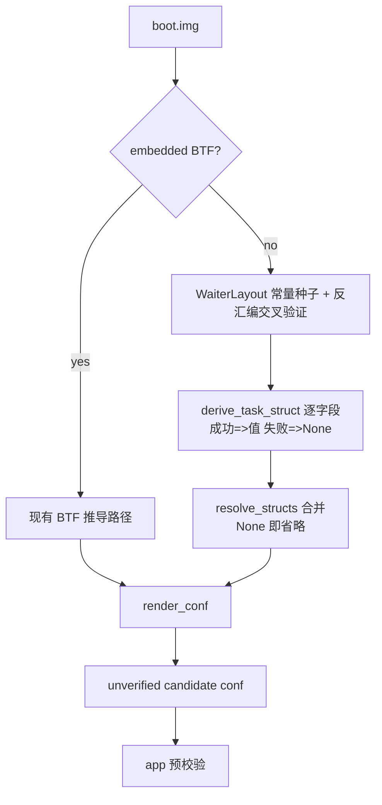

# 提取器无 BTF 结构推导计划（2026-09-30）

> 级别：L（提取器核心推导路径 + profile 字段契约）。按 `docs/development/documentation-standards.md` 模板。
> 关联 issue：YuKongA/ghostlock-app#213（OPPO A3x 5G / PKD130，`5.15.180-android13-8-o-g88bbcb96ee5e`，内核无 BTF）。

**Status.** This is the field-derivation half of
[`extractor-5x-route-geometry-plan.md`](extractor-5x-route-geometry-plan.md) and is implemented in
the same batch. That plan owns the route geometry and the Feasible/Infeasible/Unknown verdicts;
this one owns the shared `task_struct`/`cred`/`mm_struct`/`slab` derivations (phases 2–3 below,
plus the phase-1 `nf_logger` path; the phase-1 pselect work is that plan's).
The source priority is per-image derivation → measured-series constant → version/suffix heuristic;
the measured series is defined by the layout-determining config, not the release suffix. The line
references in the body predate the current extractor (`family.rs`, the verdict model) — re-check
them against `feat/extractor-ondevice` @ `32b9ca8` when implementing.

## 现状与基线

- 分支 `vr-ko-bypass-dev`，基线 commit `deff0b1`（Merge branch 'ancillary-architecture'）。
- 无 BTF 时 `resolve_structs(None)`（`tools/extract_rs/src/symbols.rs:147-161`）把 8 类结构约 25 个字段
  （`task_struct` 15、`rt_mutex_waiter`、`cred`、`seccomp`、`page`、`slab`、`mm_struct`）全部置 `None`。
- 现有反汇编推导全部以 BTF 为脚手架：
  - `derive_pselect_layout` 需 `rt_mutex_waiter.pi_tree` + `wake_state`（`derive.rs:450-458`）；
  - `derive_nf_logger_registration` 需 `nf_logger.type` 的类型与 4 字节宽度（`derive.rs:660-665`）；
  - `multicast_waiter_off` 的 waiter 字段来自 BTF（`derive.rs:968-979`）；
  - `derive_cred_5x` 需 `cred` 的 size / caps / 指针成员布局（`derive.rs:877-949`）。
- 但 `rt_mutex_waiter` 的关键偏移已被项目当作稳定 ABI：`main.rs:555` 硬编码
  `RT_MUTEX_WAITER_PI_TREE_ENTRY = 0x18` 供 multicast 推导，未走 BTF。
- `--format conf` 对缺失字段是"省略"（`report.rs:302-315`、`main.rs:482-504`），app 侧预校验拦截；
  提取器绝不用邻居 family 的猜测补齐（`README.md:46`）。

## 目标与约束

**目标**：无 BTF 时，用「ABI 常量种子 + 定向反汇编数据流推导」恢复 profile 所需结构字段，使
route 推导（`select_stack` / `multicast_waiter`）与 conf 字段契约在无 BTF 镜像上仍可产出
**unverified candidate**（语义不变，仍由 app 校验）。

**非目标**：

- 不做通用任意 struct 全反编译（不接受"把内核喂给反编译器再语义分析"这类研究级方案）。
- 不引入外部引擎（Ghidra/rizin/radare2）；不改变提取器自包含、可在 `aarch64-linux-android`
  设备端运行（`README.md:59-66`）的约束。
- 不改 GLK1/wire/profile 格式，不改 native 侧，不改 BTF 路径的既有行为。
- 不追求一次覆盖 100% 字段；每个字段独立可失败，失败即省略（沿用现有 candidate 语义）。

**约束**：

- 推导必须能对 vendor hook 改过的 `task_struct` 生效（issue 设备是 MTK OEM 内核）；
  因此不能套用 AOSP GKI 固定偏移，必须从目标镜像机器码取数。
- 真值验证优先用"有 BTF 镜像屏蔽 BTF 后与 BTF 真值逐字段对拍"，而不是只靠真机试错。

## 改动清单

逐文件（计划，非本轮实现）：

| 文件 | 改动 | 理由 |
|---|---|---|
| `tools/extract_rs/src/derive.rs` | 新增 `WaiterLayout`（按 `major.minor` 的 `rt_mutex_waiter` ABI 常量表，5.15 无 `wake_state` / 6.1+ 有）与反汇编交叉验证 | waiter 偏移是 ABI 常量，替代 BTF 作为种子 |
| `tools/extract_rs/src/derive.rs` | `derive_pselect_layout`/multicast 相关签名从 `btf: &Btf` 改为 `layout: &WaiterLayout`（或 `struct_fields: &StructFields` 抽象） | 解耦 BTF 依赖；BTF 路径改为构造该抽象 |
| `tools/extract_rs/src/structs.rs`（新增） | `derive_task_struct(kernel, symbols, waiter) -> BTreeMap<String, Option<u32>>`：逐字段锚点 | 无 BTF 时恢复 `task_struct` |
| `tools/extract_rs/src/symbols.rs` | `resolve_structs` 在 `btf=None` 时先调用推导，推导失败字段回落 `None` | 保持"失败即省略" |
| `tools/extract_rs/src/main.rs` | 无 BTF 分支下调用推导；日志区分 `derived` 与 `missing` | 可观测、可审计 |
| `tools/extract_rs/src/derive.rs` | `derive_nf_logger_registration` 的 `nf_logger.type` 在无 BTF 时用常量 `0` + 4 字节校验（`type` 是结构首字段） | 移除最后一个 route 推导的 BTF 硬依赖 |
| `tools/extract_rs/src/report.rs` | 仅在字段来源为推导时补注释/日志（格式不变） | 不改输出契约 |

### 字段-锚点表（核心设计）

种子常量 `rt_mutex_waiter`（`struct rb_node` = 24 字节，指针 = 8）：

| 字段 | 5.15 | 6.1+ |
|---|---|---|
| `tree` | 0x00 | 0x00 |
| `pi_tree` | 0x18 | 0x18 |
| `task` | 0x30 | 0x30 |
| `lock` | 0x38 | 0x38 |
| `wake_state` | 不存在 | 0x40 |
| `prio` | 0x40 | 0x44 |
| `ww_ctx` | 0x48 | 0x48 |
| `ww_waiter` | 0x58 | 0x58 |

`task_struct` 字段推导锚点（符号取自 kallsyms，模式匹配 + 数据流交叉验证）：

| 字段 | 锚点函数 | 模式 / 推导依据 |
|---|---|---|
| `cred` / `real_cred` | `commit_creds` | 相邻两条 `str` 到 `[task, #off]`；`task` 来自 `sp_el0`；两偏移相邻（±8） |
| `pid` / `tgid` | `__arm64_sys_getpid` / `__arm64_sys_gettid` | `mrs xN, sp_el0; ldr wN, [xN, #off]` 后立即 `ret` |
| `tasks` | `copy_process` 或 `release_task` | `list_add_tail(&p->tasks, &init_task.tasks)`：`add x1, init_task_symbol, #off` 与 `add x0, p, #off` 同偏移 |
| `prio` / `normal_prio` | `effective_prio` / `__sched_setscheduler` | `effective_prio` 读 `[p, #prio]`；`__sched_setscheduler` 写 `normal_prio`/`prio`，两者相差 8（中间 `static_prio`） |
| `pi_lock` / `pi_waiters` / `pi_blocked_on` / `pi_top_task` | `task_blocks_on_rt_mutex`、`rt_mutex_adjust_prio_chain`、`rt_mutex_setprio` | 以 `waiter->task`(0x30) 为种子取 `task`；`plist_add(&waiter->pi_list, &task->pi_waiters)`、`raw_spin_lock(&task->pi_lock)`、`task->pi_blocked_on = waiter`、`task->pi_top_task` |
| `seccomp` | `__secure_computing`（`CONFIG_SECCOMP`） | `ldr wN, [task, #seccomp]`（`mode` 是 `struct seccomp` 首字段） |
| `comm` | `__set_task_comm` | `add xD, task, #comm` 后 16 字节 `stp`/`str`（或内联 `memcpy`） |
| `sched_task_group` | `sched_move_task` | `task_group(tsk)` 内联访问 `[tsk, #sched_task_group]` |
| `atomic_flags` | 待定（`set_task_cpu` / 调度迁移路径） | 该字段无稳定单锚点，列为"best-effort；无法唯一锚定则省略并报告" |

`cred` 布局（5.x）：在 `commit_creds` 上下文以 `task->cred` 指针为种子，读取 `init_cred` 缓冲，
按 `derive_cred_5x` 的既有算法（`select_cred_caps` / `select_cred_refs`）恢复 caps 与引用；
size 由 `cred->cap_ambient` 之后的指针成员排列闭合，无法闭合则省略。

Mermaid（控制流；权威图放本文件）：

## 数据流/控制流差异

- 旧：`btf=None` ⇒ `resolve_structs` 全 `None` ⇒ conf 只有符号/公共块。
- 新：`btf=None` ⇒ 先跑推导 ⇒ 命中字段有值、未命中仍 `None`；BTF 存在时路径完全不变。
- 不变量：字段来源不改变 profile 字节语义；推导值不写入任何"已验证"标记；BTF 路径与推导路径
  产出同一个 `ResolvedStructs` 形状。攻击 runtime 与 wire 格式零改动。

## 兼容性与回滚

- 新增代码全部在 `btf=None` 分支，BTF 行为不变，可作为开关回滚（保留 `--no-struct-derivation`
  或直接 revert 该分支）。
- 不触碰 `kernelsnitch/`、`LegacyProfileConverter.kt` 与 v1 转换。

## 验证矩阵

| 阶段 | 命令 | 预期 |
|---|---|---|
| 单元 | `cargo test --release --manifest-path tools/extract_rs/Cargo.toml` | 固定反汇编向量 → 期望偏移全部通过；既有测试不回退 |
| 真相机对拍 | 取有 BTF 的镜像（如 5.15.189 / 6.6.89），屏蔽 BTF 后跑新推导 | 推导值 == BTF 真值（逐字段 diff 为空），或差异可在锚点审查中解释 |
| 构建 | `./gradlew exportKernelProfiles` / NDK 构建 | 零警告 |
| 真机门禁 | 目标设备（issue 213）冷机、单 route、KernelSU 未加载 | route 命中、写验证通过；日志归档 `docs/analysis/device-gates/` |

前置依赖：阶段 2/3 的锚点必须用**目标或同类镜像**核对（无 BTF 真值 vs BTF 真值对拍），
需要 `5.15.180` 或任一可屏蔽 BTF 的镜像文件；无镜像只能停在阶段 1 + 单元测试。

## 方法论的版本泛化性与边界（2026-10-23）

本节回答审查者必然提出的问题：反汇编推导在多大程度上适用于其他内核版本。结论先行：
**流水线是版本泛化的，锚点集是按 ABI 家族扩展的**；跨家族的输出在验证前一律是
Unknown/省略，不会产出错误 profile。

### 与版本无关的部分

- **符号定位**：全部锚点经恢复的 kallsyms 定位后从镜像反汇编取得；基址与 KASLR
  slide 均来自镜像本身，不写死地址。
- **数据形状锚点**（`structs.rs`）：`comm` 取唯一 8 字节对齐、NUL 结尾的 `"swapper"`；
  `real_cred`/`cred` 取两个相邻的 `init_cred` 指针；`sched_task_group` 取唯一的 root
  task group 指针；`prio`/`normal_prio` 取唯一三个相等的 100..=139 优先级；caps 取
  `init_cred` 中最长的等值掩码串。这些锚点只约束**关系**，偏移是输出而非输入：字段
  移动位置仍可恢复，只要关系不变。
- **栈帧算术**（`derive_pselect_layout`、`derive_sigreturn_layout`）：shift 与 sigreturn
  偏移由镜像自身的 `sub sp`/`stp`/`adrp+add`/访存指令算出，编译器帧变化会随之变化。
  固定常量只有分类器（`off + 0x58 <= 0x200`、`delta/8 <= 4`），它们描述 route 自己的
  字表，不是内核布局。
- **BTF 路径**：结构布局自描述、版本无关；反汇编推导只是无 BTF 时的回退。
- **失败语义**：每个锚点可独立失败，失败即省略/Unknown，绝不猜测；模板与 patch-range
  只在 IKCONFIG 指纹匹配时启用，且逐字段标记来源。版本漂移因此是安全退化，而不是
  静默出错。

### 需要按家族扩展的部分

模式匹配器编码的是字段在机器码中的**用法**，不保证跨版本稳定：

- `copy_process` 的 pid 锚点匹配 `ldr wD, [pid, #0x60]` + `str`：`0x60` 是 `struct pid`
  内 `numbers[0].nr` 的 5.10 布局常量；该偏移变化则匹配不到。
- PI 四连零存储编码 5.10 的两字 `plist_head`：要求 `waiters+8` 为 list head 第二字、
  `pi_top_task = waiters+0x10`、`pi_blocked_on = top+8`，且 `pi_lock` 在 `waiters` 前
  0x40 内；plist 或字段顺序改变即失效。
- 辅助函数按**符号名**定位：`__arm64_sys_pselect6`、`core_sys_select`、`do_futex`、
  `futex_wait_requeue_pi`、`__arm64_sys_rt_sigreturn`、`restore_sigframe`、
  `restore_fpsimd_context`、`restore_sve_fpsimd_context`。内联、改名或新增辅助层会使
  调用链校验失败并正确返回 Unknown（`do_pselect` 已按可选符号处理）。
- `WaiterLayout` 无 BTF 时回退 `family::waiter_layout_5_10()`（`pi_tree 0x18`、
  `task 0x30`、`lock 0x38`），由 `is_5_10(release)` 选择；5.15/6.1 需要补一行常量表。
- `nf_logger` 的 `type` 偏移 8 与 `ULOG=1`/`MAX=2`/`NFPROTO_UNSPEC=0` 是本 ABI 世代的
  结构事实。

### 已测得的边界

- 同一 ABI 家族内：14 个镜像（5.10.43–5.10.246，跨补丁版本、ROM 配置与构建变体）
  全部通过 `tests/structs_ondevice.rs` 的逐字段对拍。
- 同版本、不同编译配置即可破坏匹配器：自定义 LTO/`-Os` 的 5.10.236 只闭合 6 个字段
  （`init_task` 数据锚点）；系列模板补齐其余字段，profile 仍正确——但 out-of-series
  的同类镜像可能只能得到部分字段。
- 编译器变体实测（2026-10-23，同一份源码与配置）：`-Os+FullLTO` 下 `copy_process` 的
  9 个锚点全部失效、`init_task` 数据锚点与 cred caps 仍闭合（6/15），模板补齐；
  `-Os+LTO_NONE+CFI off` 下模板因指纹不匹配（`CONFIG_CFI_CLANG`）而停用，输出只剩
  6 个字段、路由全部 Unknown——这是设计允许的安全降级，不是错误值。
- **限制及其可缓解性（2026-10-24，同日随后移除）**：`mm_struct_sz` 曾是 SLUB stride，不是
  `sizeof(mm_struct)`，无法仅从 Image 推导（BTF 给 sizeof；slab 合并/对齐会改变对象大小，
  6.1 为 0x3c0 对 1024）。**已在 `7f859eb` 把 leak 改为 stride-agnostic 扫描后，从 profile
  契约中整体移除了该字段**：主路径 S=32、兜底 S=8、外层 4 KiB；spray sizing 使用 native 的
  `MM_STRUCT_SZ` 默认值，提取器不再输出任何 stride 猜测。**设备实测（2026-10-24，
  microbenchmark，40 GiB 直接映射跨度，6 线程）**：S=960 0.8 s，S=32 20 s，S=8 80 s；
  外层 4 KiB 与 32 KiB 同价；tag 扫描（V=15）在 S=32 下 263 s；按 iomem RAM bank 过滤
  （~13 GiB）可再降约 3×。设备门禁中 bank 过滤后实际 leak 为 0.9–4.0 s；错误的 profile
  stride（1024）不再影响 leak 结果。设计与完整实测见
  [`kernelsnitch-stride-fallback-plan.md`](kernelsnitch-stride-fallback-plan.md)。
- **可部署性由另一组不变量决定**，与提取器的布局判断无关：vermagic、7,252 个导出符号的
  CRC/class/namespace、`module_layout` CRC。测试镜像的 `meta.txt` 以
  `deployable = yes/no` 标注；本轮只有 ksun-osize 满足（与 stock 的 vermagic/KMI 逐字节
  一致，已 RAM boot 与烟测），另两个变体缺 `-ab14313284` 后缀或 CFI，仅供离线提取测试。
- 跨家族（5.15/6.1）**未验证**：测试镜像库只含 5.10；6.1 设备有 BTF，提取走 BTF 路径，
  反汇编锚点未在该家族上对拍。issue 213 的 `5.15.180` 是第一个跨家族候选。

### 编译器变体：布局不变，模式会变

编译器参数（`-Os`、LTO）改变的是指令选择与内联边界，不是 `offsetof`：

- **结构布局由配置与源码 ABI 决定**，与优化级别无关。因此只要 IKCONFIG 指纹命中
  已测系列，模板补齐的字段在任意编译参数下都正确——`ksun-osize` 正是如此：只闭合
  6 个字段（全部来自 `init_task` 数据锚点），其余由系列模板补齐，profile 仍然正确。
- **代码模式是编译器相关的假设**：LTO 跨符号内联、`-Os` 改用 `str wzr`/`stp`/重排，
  `copy_process` 里"连续四条零存储"这类惯用法可以整体消失。数据形状锚点（`comm`、
  相邻 cred 指针、相等优先级串）不受影响——`ksun-osize` 的 6 个字段即为证据。
- **栈帧本质上编译器相关**，因此 route 几何从不查表，而是逐镜像从指令算出。

所以限界只在**配置出系列 + 无 BTF + 非常规编译**三者叠加时出现：模板不可用、模式
弱化，得到的是"部分字段"的 unverified candidate。缓解手段按代价排序：自建内核直接
开 `CONFIG_DEBUG_INFO_BTF`（与编译器无关，直接移除无 BTF 路径）；谓词匹配 + 系列
模板（已实现）；惯用法归一化（`wzr`/`xzr` 互换、接受 `stp` 成对存储、放宽符号窗口、
内联缺失时按符号改反汇编被调函数）；按家族补锚点；以及可观测镜像上的运行时真值
（QEMU `/proc/kallsyms` + `/proc/slabinfo`、kprobe 回读、自建内核的 DWARF）。
四者皆不可得时没有自动解法——此时输出保持省略并标注未验证，这是拒绝，不是错误
profile。

### 检测与升级路径

- **检测**：逐字段 `field_source` 日志 + IKCONFIG 系列谓词 + QEMU 内核真值对拍
  （启动同一镜像，读 `/proc/kallsyms` 与 `/proc/slabinfo`，比对十项 offset 与锚点）。
  反汇编推导在通过该对拍之前只是假设。
- **升级一个新家族**：补 waiter 常量行 → 按该家族的符号名与代码形状调整锚点 → 用该
  家族的 BTF 镜像屏蔽 BTF 做逐字段真值对拍 → QEMU 十项对拍。在此之前输出为
  Unknown/省略的 unverified candidate，不会成为"已验证"。

## 明确保留

- BTF 解析与 BTF 优先路径、`derive_pselect_layout` 的算法与不变量、`unverified candidate` 语义、
  profile/GLK1 格式、native 全部代码、`kernel_layout_verified` 门限。

## 进度

- [x] 阶段 1：`WaiterLayout` + waiter 字段交叉验证；`derive_pselect_layout` 去 BTF
- [x] 阶段 1：`nf_logger.type` 无 BTF 路径（2026-10-23）。**修正**：`type` 是
      `struct nf_logger` 的第二字段，偏移 **8**（不是首字段 0）；无 BTF 用常量
      `ULOG=1`/`MAX=2`/`NFPROTO_UNSPEC=0`，结构校验通过后取实测 KASLR 锚点
      `loggers+0x10`（不是 ULOG 槽 `loggers+8`）。14 个镜像全部通过，值等于各
      profile 的 `offset.slide_loggers_0_1`/`slide_nfulnl_logger`。
- [x] 阶段 2：`task_struct` 主要字段推导（2026-10-21）：`init_task` 数据锚点恢复
      `comm`/`cred`/`real_cred`/`sched_task_group`/`prio`/`normal_prio`，`copy_process`
      锚点恢复 `pid`/`tgid`/`tasks` 与四个 PI 字段，共 13/15；`seccomp` 于 2026-10-23
      增加 `__secure_computing`/`copy_seccomp` 锚点（见进度末条），现为 14/15；
      `atomic_flags` 无稳定单锚点，按设计省略。**限制（2026-10-22）**：自定义 LTO/`-Os`
      5.10.236 Image（`ksun-osize`）的 `copy_process` 模式改变，只闭合 6 个字段
      （`init_task` 数据锚点）；系列指纹匹配时模板补齐其余字段，profile 仍正确，
      但非默认编译器配置的 out-of-series 镜像可能只能得到部分字段。
- [x] 阶段 3（部分）：`cred` 的 caps 与 refs 从 `init_cred` 推导（caps 40/5，refs
      128/136/144，`copy_size` 仍为系列常量）；`atomic_flags`、`page`/`slab`/`mm_struct`
      未推导。
- [x] 5.10 真相机对拍（2026-10-21）：14 个测试镜像逐字段等于实测系列
      （`tests/structs_ondevice.rs`）；BTF 屏蔽对拍与真机门禁未做（镜像库无带 BTF 的 5.10 镜像）。
- [x] 跨家族对拍（2026-10-23）：新增 `tests/families_ondevice.rs`。6.1.138（POCO
      `duchamp`，内置 BTF）对拍 app 的 bundled profile：`route`/`task_struct`/`cred`/
      `kernelsnitch`/`offset` 的 51 个非空字段全部相等（`include` 展开后比较）；
      `--no-disasm` 负向断言确认不会泄漏 5.10 的 `loggers+0x10`。镜像与 `meta.txt`
      入 `external/test-kernels/6.1.138-android14-11-g44bda9e8f6e9-ab13792638/`
      （`profile.conf` 为同 release 的 bundled 资产，上游来源、非本仓库真机验证）。
- [x] `loggers` 无 BTF 回退按家族门控（2026-10-23）：`symbols::loggers_anchor_fallback`。
      有 BTF 时用枚举索引（`loggers+ulog*8`，6.1 实测 `+8`）；5.10 系列保留实测
      `+0x10` 并记为 heuristic；其他家族无 BTF 时省略，不再输出外来常量。65 个提取器
      单测、14 镜像 `structs_ondevice`、6.1 跨家族对拍全绿。
- [x] BTF 屏蔽真值对拍（2026-10-23）：4 个 Pixel 7 `panther` 5.10 镜像
      （5.10.157/189/209/214，内置 BTF）→ `tests/btf_truth_ondevice.rs`。结果：
      实测系列的 15/15 字段等于镜像 BTF；已推导字段全部等于 BTF；cred caps
      `0x28/5`、refs `[128,136,144]` 与 BTF 一致。**新发现**：这些 vendor 编译器下
      `copy_process` 锚点只闭合 6/15（全部是 `init_task` 数据锚点），而 IKCONFIG 指纹
      仍然匹配、模板补齐其余字段——模式对编译器比预想更敏感，`init_task` 数据锚点
      是目前唯一跨代码生成稳定的来源。profile 仍正确；out-of-series 镜像需注意覆盖度。
- [x] 代码生成矩阵（2026-10-23）：从 `external/diting-mcast` 已有的 vmlinux 生成并入库
      三个变体（ksun `-Os+FullLTO+CFI+KSU`、full-osize `-Os+FullLTO+CFI`、
      full-none-os `-Os+LTO_NONE+CFI off`）。新增 `tests/codegen_ondevice.rs`，以
      `meta.txt` 的 `series`/`template`/`min_derived_task_fields` 驱动：所有非空
      `task_struct` 值必须等于实测系列（soundness），`template:` 只允许在指纹匹配时出现，
      指纹不匹配只允许 derived/null，`nf_logger` 失败必须标 heuristic，`--no-disasm`
      也必须标 heuristic。三个变体全部通过，每个变体都保留了 6 个 `init_task` 数据锚点。
- [x] `task_seccomp` 锚点（2026-10-23）：主锚点是 `__secure_computing` 里
      `current->seccomp.mode` 的 32 位载入（`mrs x, SP_EL0` 后 `ldr w, [x, #0x848]`），
      `copy_seccomp` 的 16 字节结构拷贝（`ldr`/`ldp` 成对、偏移差 8）为回退，
      `__seccomp_filter` 为第二候选。14 个 5.10 镜像全部闭合为 **2120**；4 个 panther
      镜像的 BTF 真值也是 2120，推导值与之一致；3 个代码生成变体同样闭合（7 个字段）。
      **gotcha**：反汇编器把 SP_EL0 输出为编码名 `s3_0_c4_c1_0`，不是别名 `sp_el0`。
