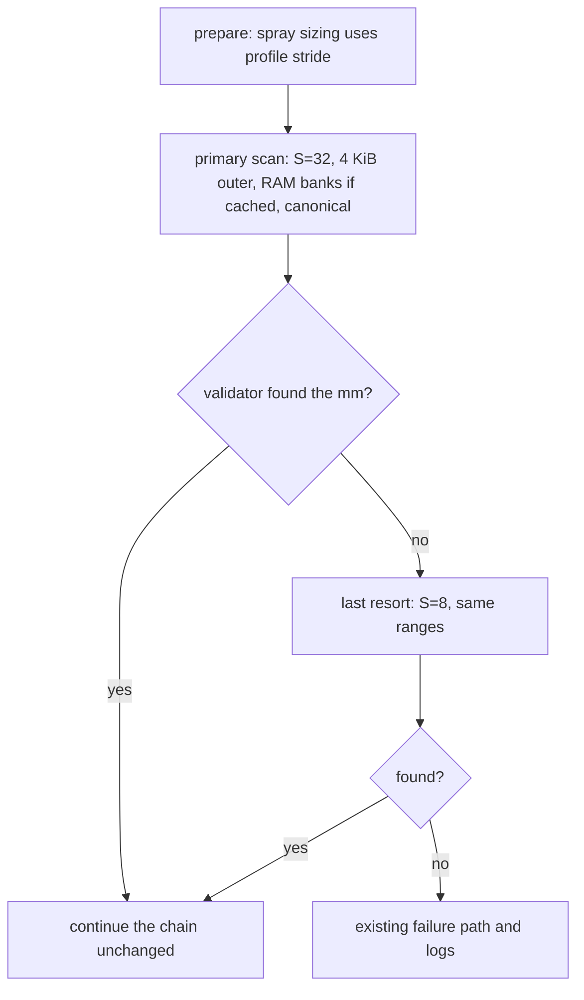

# KernelSnitch stride-agnostic leak — plan (2026-10-24)

Level: **L** (attack-critical path). Plan first, then code, per `AGENTS.md`.

Base: `document` @ `32b9ca8` (r7), branch `feat/kernelsnitch-stride-fallback` in
`external/ghostlock-app/.claude/worktrees/kernelsnitch-stride-fallback`. The `port/diting-5.10`
dev line is divergent (15/75 commits, 38 differing `src/` files) and needs its separate
reconciliation; rebase this topic onto it before the PR if `BRANCH-POLICY.md` requires it.

## Current state and baseline

`kernelsnitch.mm_struct_sz` is a per-family profile value, but it is used in two different ways:

| use | code | needs the exact value? |
|---|---|---|
| inner scan step of the mm_struct leak | `kernelsnitch.h:259` (`mm_struct_candidate += ks->mm_struct_sz`) | **no** — it is only the address grid |
| `mm_objs_per_slab = ORDER3_SIZE / stride` | `support/util.cpp:667`, sizes the prepare/spray/leak child arrays | approximately, for heap shaping |

The value is the **SLUB object stride**, not `sizeof(mm_struct)`. It cannot be read or derived by the
unprivileged app:

- `/proc/slabinfo` is `0640 root:log` and labelled `proc_slabinfo`; the app domain is denied (measured
  on the diting, SELinux Enforcing). `/sys/kernel/slab/mm_struct/object_size` is denied as well.
- BTF gives `sizeof`, which differs from the stride: the 6.1 image has `sizeof = 0x3c0` and a 1024
  stride; the Pixel 5.10 images have `sizeof = 0x3e0` (992) while the 5.10 series stride is 960.

Profile values today: diting 5.10 **960** (runtime-verified in 19/19 QEMU `/proc/slabinfo` dumps),
6.1 **1024** (device-gated on the POCO), 5.15 **1024** (upstream bundle, not measured here),
6.6/6.12 `null` → native fallback `kernel::MM_STRUCT_SZ = 0x500` (1280).

With the current single-pass leak, a wrong stride is not an error but a coverage probability: a scan
step `S` reaches object `j` of a slab only when `S` divides `j*T` (`T` = true stride). If no
candidate step divides `T`, some object positions — including `j = 1` — are never offered to the
validator. Examples (objects per 32 KiB slab):

| true `T` | step `S` | reached object indices | coverage |
|---|---|---|---|
| 960 (N=34) | 960 | all | 34/34 |
| 960 | 1024 | 0, 16, 32 | 3/34 |
| 960 | 1024 and 1280 | 0, 4, 8, …, 32 | 9/34 |
| 1088 (N=30) | 960, 1024, 1280 | 0, 15, 16, 20 | 4/30 |

So a "few family candidates" is not a coverage guarantee; a small step that divides `T` is.

The validator is already stride-independent: `__mm_candidate_matches()` compares futex hash buckets
for the candidate mm across `collisions` futex addresses (`kernelsnitch.h:223`). It is the oracle;
the stride only decides which addresses are offered to it.

## Goal and constraints

**Goal.** Make the leak succeed without knowing the true stride: the primary scan uses inner step
**32** (complete coverage for every observed family stride), and `S=8` is the last resort for a
stride that is not a multiple of 32. The profile `mm_struct_sz` was initially kept as the
spray-sizing hint; the same-day follow-up below removed it from the profile contract.

**Non-goals.**

- ~~No profile-schema or profile-value change; `mm_struct_sz` stays emitted and is still used for
  the spray sizing hint.~~ Superseded by the follow-up below: the field was removed once the scan
  merged.
- No `/proc/slabinfo` read, no root-only interface, no side channel.
- No change to the validator, futex hash, routes, or exploit stages. (The follow-up removes the
  optional `mm_struct_sz` kernel-wire slot.)
- No attempt to recover `T` for spray sizing (a possible later extension; see Open questions).

**Constraints.**

- Attack-path change: host gates plus a device gate with an archived record.
- The scan must not create false positives — the validator is unchanged.
- The primary `S=32` scan costs ~20 s over the 40 GiB span (~7 s with RAM-bank filtering), paid on
  every run including the supported 5.10 line. The operator accepted this on 2026-10-24; the old
  ~0.8 s path is intentionally dropped rather than kept as a second code path.
- `S=8` runs only when the primary `S=32` pass finds nothing; it is the universal last resort.
- The app's native-stage timeout must accommodate ~25 s; decide from the device gate.

## Why it works

Objects sit at `base + j*T` inside a 32 KiB slab. A step `S` that divides `T` reaches every object.
The observed strides (960, 1024, 1088, 1216, 1280) are all multiples of 32; any 8-aligned SLUB object
is a multiple of 8. Therefore:

- `S = 32` covers every observed/plausible family stride (all multiples of 32).
- `S = 8` is universal for any 8-byte-aligned object, at higher cost.

The outer loop also assumes the slab order (`MM_ORDER = 3`, 32 KiB slabs). Stepping the outer loop
at 4 KiB removes that assumption; the measurement shows it is free (candidate count is unchanged;
only the slab-grid overhead grows, and it is negligible).

The `S=32` grid is a superset of the old `S=960` grid (32 divides 960), so the change cannot lose a
candidate the old path would have offered; it only adds candidates at the intermediate offsets. The
found address is still accepted only by the unchanged futex-bucket validator.

## Design

1. **Primary scan:** inner step **32**, outer step **4 KiB**, canonical address first, then the
   existing tag pass only if the canonical pass fails. Restrict the ranges to the RAM banks from the
   `.ghostlock_iomem` cache when it matches the release; otherwise use the existing
   `[identity_start, direct_map_end]` span. Cost: ~20 s over the 40 GiB span, ~7 s bank-filtered.
2. **Last resort:** inner step **8**, same outer step and ranges. It is the universal grid for a
   stride that is not a multiple of 32; it is paid only when the primary pass finds nothing.
3. **Spray sizing** initially kept `profile.mm_struct_stride(kernel::MM_STRUCT_SZ)`. It is a soft
   value; the gate must show that a wrong value does not independently break the chain (see
   Falsifier). The follow-up below replaces the profile input with the compiled `MM_STRUCT_SZ`.
4. **Failure:** if both passes fail, keep the current failure result and logging.

Range walker: the scan takes a list of `[start, end)` ranges instead of one span. With the iomem
cache the list is the System RAM banks (sum ≈ 13 GiB on the diting); without it, one range from the
identity start to the measured direct-map end (40 GiB with the cache; 48 GiB without).

Logging: one line per pass with `pass=primary|s8`, grid (`inner`, `outer`), range source
(`span|banks`), elapsed ms, and `found=0|1`. The profile generation log is unaffected — this is the
native run log.

## Change list

| file | change | reason |
|---|---|---|
| `src/core/kernelsnitch/kernelsnitch.h` | parameterize `__run_mm_leak_pass` with `inner`/`outer` and a range list; keep `context_init` and the validator unchanged | the primary and last-resort scans are the same loop with different grids |
| `src/core/kernelsnitch/kernelsnitch.h` | range walker that accepts multiple banks | avoids scanning the holes in the 40 GiB span |
| `src/core/support/util.cpp` | run the primary `S=32` scan, then `S=8` only on failure; log each pass | entry point; the profile stride no longer feeds the leak, it stays the spray-sizing hint |
| `src/core/attack/ops.cpp` | store the System RAM bank ranges parsed from `.ghostlock_iomem` (currently only `span` is kept) | bank-filtered ranges when the cache exists |
| `src/core/tests/` | host test of the grid coverage arithmetic for `T ∈ {960,1024,1088,1216,1280}` and `S ∈ {32,8}` (plus the old 960 as the control) | proves the coverage claim without a device |
| `tools/kernelsnitch-scan-bench.cpp` (new, optional) | preserve the measurement harness used below | reproducibility; the operator decides whether it is committed |

No Kotlin/app change. No profile field. The spray algorithm is unchanged; only the scan grid is
re-parameterized.

## Data/control-flow differences

- Old: one scan pass with the profile stride; a wrong stride was a coverage probability, not an
  error.
- New: primary `S=32` (4 KiB outer, banks when cached), then `S=8` only on failure. The profile
  stride is no longer a leak input; the supported 5.10 line pays ~20 s (~7 s bank-filtered) instead
  of ~0.8 s.
- Invariants: the validator, futex hash, process/thread structure, and failure semantics are
  unchanged. The `S=32` candidate set is a superset of the old `S=960` grid. The same found-address
  is required to drive the rest of the chain; no new kernel state is touched.
- Ordering: the tag sweep stays after the canonical pass and only runs if canonical fails; each rung
  repeats the same order.

## Measurements (the justification)

Benchmark: `tools/kernelsnitch-scan-bench.cpp` (added 2026-10-24). It mirrors the leak grid
(`coarse` 1 GiB → `outer` → `inner`) and calls the real `futex_hash_context_bucket` with
`collisions = 8`; it does no kernel access. Device: diting, `5.10.236`, 6 online cores (core_ctl
paused 2), SELinux Enforcing. Range: 40 GiB direct-map span from the cached iomem (base
`0x80000000` rounded to 1 GiB, top `0xa80000000`); without the cache the bound is 48 GiB. Each row is
a 4 GiB slice extrapolated ×10 (the 1 GiB nominal run confirmed linear scaling).

| inner `S` | outer | validations | 4 GiB | 40 GiB estimate |
|---|---|---|---|---|
| 960 (nominal) | 32 KiB | 1 | 0.080 s | **0.8 s** |
| 1024 | 32 KiB | 1 | 0.075 s | 0.75 s |
| 32 | 32 KiB | 1 | 1.997 s | **20 s** |
| 8 | 32 KiB | 1 | 7.97 s | **80 s** |
| 32 | **4 KiB** | 1 | 1.997 s | 20 s — outer step is free |
| 960 | 32 KiB | 15 (tag pass) | 0.906 s | 9.1 s |
| 32 | 32 KiB | 15 (tag pass) | 26.3 s | 263 s |

Single-thread nominal: 0.099 s/GiB; six threads scale ~5×. With RAM-bank filtering (~13 GiB instead
of 40) the fallback estimates become ~7 s at S=32 and ~27 s at S=8. The tag pass is only needed for
non-canonical addresses; the direct map is canonical, so the expected fallback is the S=32 row.

Caveats: microbenchmark, compute-only; excludes the collision setup and process spray; device
frequency/thermal variation; 4 GiB slices are extrapolated linearly (validated by the nominal 1 GiB
run). The real stage's thread count is `sysconf(_SC_NPROCESSORS_ONLN)` (6 here; 8 when all cores are
online, ~25 % faster).

**Chosen design:** the `S=32` row is the primary path; the 960/1024 rows are kept only as the cost
of the discarded fast path. The operator accepted ~20 s per run (~7 s bank-filtered) on 2026-10-24,
which is why the plan drops the fast pass instead of adding a second code path.

**Device observation (2026-10-24):** in the gate runs, the bank-filtered scan reported
`ranges=14 source=banks` and the leak completed in **0.9–4.0 s** (the `+Nms` line after the scan),
better than the ~7 s estimate; the 4 GiB-slice benchmark remains conservative.

## Compatibility and rollback

- No profile, wire, route, or app change. The scan change is internal to the native leak.
- Rollback is a revert of the native change; the old single profile-stride pass returns. Nothing in
  the profile or app needs to change in either direction.
- The scan ladder is compile-time (`32`, then `8` on failure); no new user-visible setting.
- Timeout interaction is an open question: the native stage must not be killed during the ~20 s
  primary scan (up to ~80 s on the `S=8` rung). The gate records elapsed time and the run-store
  state.
- The tag sweep is unbounded at `S=32` (263 s measured). Decide whether to cap it or accept it before
  the device gate; canonical direct-map addresses should make it unreachable.

## Validation matrix

| stage | command | expected |
|---|---|---|
| host build | `make -C src ghostlock` | zero warnings |
| host lint | `make -C src lint-tidy` | exit 0 |
| host tests | `make -C src native-host-tests` | known ARM `yield` asm block; do not claim it passed |
| coverage unit | new test: `T ∈ {960,1024,1088,1216,1280}`, `S ∈ {32,8}` (960 as the old control) | `S=32/8` reach every `j`; an old step that does not divide `T` misses `j=1` |
| disassembly | `tools/cmp_disasm.py` before/after | per-target counts; the known multicast baseline FAIL is unchanged |
| device control | correct 960 profile, fresh boot | primary `S=32` finds the mm; elapsed ~20 s span / ~7 s banks; chain behaves as today |
| device falsifier | profile with 1024 stride on the 960 kernel | the leak is unchanged (the scan no longer reads the profile stride) and finds the mm; the spray uses 1024; the chain reaches the same stage classes |
| device timing | scan logs | elapsed ≤ ~30 s span-only, ≤ ~10 s bank-filtered at `S=32`; run store not `interrupted` |
| device regression | normal supported profile | no `S=8` line; unchanged completion class |

Falsifier detail: the scan no longer reads the profile stride, so a wrong profile value isolates the
spray sizing only — the leak result should be identical to the control. If the chain fails at the
spray while the mm was found, add a temporary test-only override for the spray value to separate the
two; that override is not shipped.

Decision rule (pre-registered): accepted if `S=32` finds the mm in 5/5 control runs and 5/5
wrong-profile-stride runs, the scan elapsed time stays within the budget above, and the chain reaches
the same stage classes as today. Chain completion remains the device's usual ~55 % property, not a
scan criterion.

## Explicitly unchanged

- ~~`profile` schema, `kernelsnitch.mm_struct_sz` values, generation logs, and the app's extractor.~~
  Superseded by the follow-up below: the field is gone from the schema, the extractor and the
  bundled profiles.
- The validator, futex hash, collision phase, and tag-sweep order.
- The spray algorithm; only its stride input changed (the compiled `MM_STRUCT_SZ` default).
- The route/exploit stage machine and handoff.
- The profile-side limitation: the unprivileged app still cannot read `/proc/slabinfo`; the scan
  no longer needs it, and the spray uses an approximate default.

## Follow-up (2026-10-24): remove the stride from the profile

After `7f859eb` merged to `document`, the operator directed that the value no longer appear in the
profile: with the leak stride-agnostic, the extractor was still emitting a family guess (960/1024)
it cannot derive. The follow-up removes it end to end:

- **Profile contract:** `kernelsnitch.mm_struct_sz` is gone from the Kotlin model, the wire schema
  and the native `KernelMisc`; the native spray sizes with the compiled `MM_STRUCT_SZ` default
  (0x500, 25 objects per 32 KiB slab). Spray shaping is the only consumer left, and the device
  falsifier showed a wrong stride (1024) still leaked the mm and reached W1–W3 — the leak cannot be
  hidden by a wrong shaping value. The field was already optional, so a profile that omits it
  behaves exactly like the old `null` fallback.
- **Extractor:** the `kernelsnitch` block carries only `collisions`; the 5.10 960 / 6.1 1024 seeds,
  the non-series-heuristic warning and the JSON `mm_struct_sz` field are removed.
- **Bundled profiles/templates and the app:** every asset drops the line; the advanced editor no
  longer shows it; multicast validation no longer requires it; legacy import drops the old flat
  key instead of carrying it into the namespace.
- The native scan is unchanged (merged as `7f859eb`).

## Open questions

1. **Resolved (2026-10-24):** primary `S=32`, `S=8` only on failure. The operator accepted the
   ~20 s (~7 s bank-filtered) cost on every run, so the old fast pass is dropped.
2. Bank filtering: only when `.ghostlock_iomem` exists and matches the release; otherwise the full
   span. Parse the bank list at `apply_iomem_cache()` time and store it in the session.
3. Native-stage timeout: which limit wraps the leak, and does it need an allowance for ~20 s (up to
   ~80 s on the `S=8` rung)? Measure first; do not change route knobs.
4. Falsifier: no test-only scan override is needed — the scan no longer reads the profile stride, so
   a wrong profile value isolates the spray sizing. Add a spray-only override only if the falsifier
   fails at the spray while the mm was found.
5. Tag sweep: cap or accept the 263 s worst case at `S=32`; canonical direct-map addresses should
   make it unreachable.
6. Optional later: recover `T` from the gcd of two leaked mm addresses for exact spray sizing.
7. Branch/placement: based on `document` @ `32b9ca8` in
   `.claude/worktrees/kernelsnitch-stride-fallback`; rebase onto the reconciled `port/diting-5.10`
   before the PR if `BRANCH-POLICY.md` requires it.

## Progress

- [x] Problem quantified: divisor coverage condition; family-candidate sets are probabilistic
      (2026-10-24).
- [x] Cost measured on the diting (benchmark, 40 GiB span; table above) (2026-10-24).
- [x] Plan written (2026-10-24).
- [x] Branch/worktree created on `document` @ `32b9ca8` (2026-10-24).
- [x] Design revised to `S=32` primary / `S=8` last resort; operator approved and accepted the
      ~20 s per-run cost (2026-10-24).
- [x] Host implementation + unit coverage test + host gates (2026-10-24):
      `make -C src ghostlock` zero warnings; `make -C src lint-tidy` exit 0;
      `build/host-test/scan_grid_test` passes; `cmp_disasm.py` (baseline = `document` @ `32b9ca8`,
      candidate = this branch) reports layout shifts in owner/waiter/consumer/do_kernel5/
      do_one_write, one **SHAPE-DIFF** in `run_main_route_threads` (`ldr x0,[x8]` →
      `ldr x0,[x8,#0x688]`) caused by the new `.bss` globals shifting a folded symbol offset, and
      the two known MISSING `multicast_*` symbols; APK 639 built (md5 `a4c28e95…`).
- [x] Device falsifier/control gate (2026-10-24, partial): control `20261024-024717` completed
      (`KernelSU ready`) with `scan inner=32 outer=4096 ranges=14 source=banks`, leak 0.9–4.0 s;
      falsifier `20261024-025437` (`mm_struct_sz=1024`) leaked the mm in 3493 ms and reached
      W1–W3, then hit the known `sched_setaffinity EINVAL` (core_ctl) and exited 255. Record:
      `docs/analysis/device-gates/kernelsnitch-stride-2026-10-24.md`; evidence
      `external/port/kn-stride/{control-1,falsifier-2}`. The pre-registered 5/5 per cell was not
      run; a 5/5 series with `cpu-active-hold.sh` remains optional before merging.
- [x] Follow-up (2026-10-24): the profile field, its extractor seeds and every bundled value were
      removed; the native spray uses `MM_STRUCT_SZ`. Host gates and the extractor test suite were
      rerun on the rebased branch.
- [ ] PR branch and release decision.
